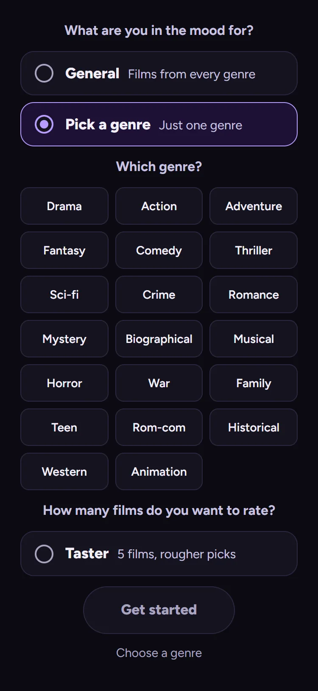
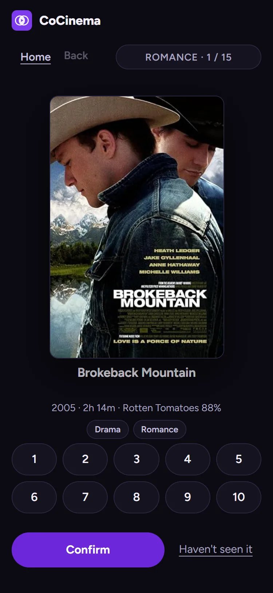
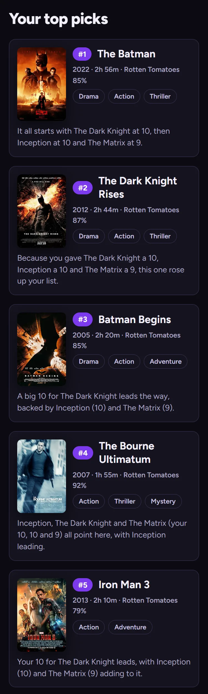
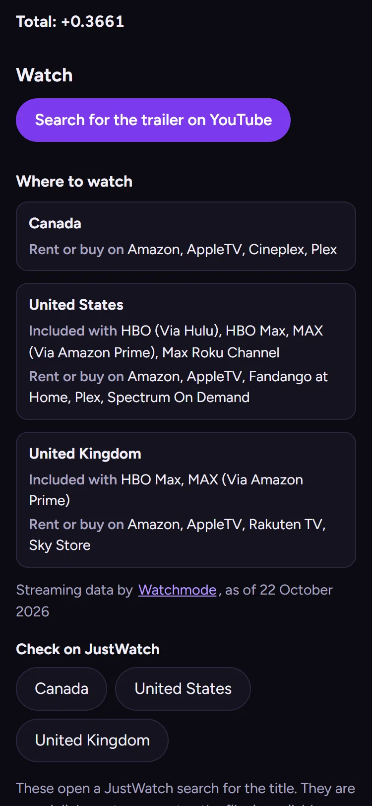
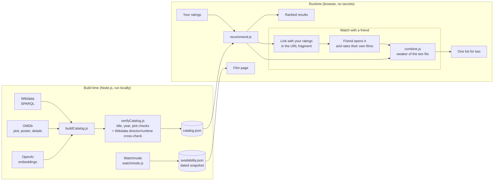

<p align="center">
  
</p>

# CoCinema

**Rate a few films you know, and I'll tell you what to watch next, and why.**

Live: **[cocinema-pi.vercel.app](https://cocinema-pi.vercel.app)**

<p align="center">
  
  
  
  
</p>

## What it does

- **Rate films** on a 1 to 10 scale, one at a time. Pick how long: Taster (5), Quick (10) or Full (15). Haven't seen one? Skip it.
- **General or one genre.** Rate across everything, or pick a genre and get picks only from that genre.
- **Top picks with a reason each**, built from your own ratings ("Your 9 for X did most of the work here..."), then the rest of the list.
- **Film pages** with the plot, how your ratings pushed it up or down, and where to stream it in Canada, the US and the UK.
- **Watch with a friend.** Send a link, your friend rates their own films, and you both get one list that suits you both.

## How it works

I used AI in exactly one place, offline: each film's plot was turned into an embedding (a list of numbers where similar stories get similar numbers), once, at build time.

Everything after that is maths I wrote, running in your browser. Your ratings are mean-centred (a 7 from a harsh critic counts for more than a 7 from someone who gives everything a 9), blended into one taste profile, and every film is ranked by cosine similarity to it. No AI picks your movies, there's no account, and there's no server. Your ratings stay on your device.

## The pipeline

1. **Wikidata** finds the best-known films in each genre.
2. **OMDb** adds plots, posters and details, with a title check that rejects wrong matches.
3. **OpenAI `text-embedding-3-small`** turns each plot into 512 numbers, once.
4. **`buildCatalog`** merges it all into one file the browser loads: 550+ films.



## Run it locally

```bash
npm install
npx serve . -l tcp://127.0.0.1:3000   # then open http://127.0.0.1:3000/src/
```

The site needs no keys. Only to rebuild the data, add a `.env` with `OMDB_API_KEY`, `OPENAI_API_KEY` and `WATCHMODE_API_KEY`, then run `node scripts/buildCatalog.js`.

## Tests and evaluation

- **Unit:** `npm test`, 277 tests (node:test) on the recommender, why lines, sharing links and catalog integrity.
- **Browser:** `npm run test:e2e`, 523 checks across 14 headless Chrome scripts, including an axe accessibility scan.
- **Evaluation:** `npm run evaluate`. For 1,000 simulated fans of one genre, 59.8% of their top 10 is from that genre, against a 16.2% baseline (a lift of 4.6x). Honest caveat: those are simulated taste profiles, not real users.

## Stack

Plain JavaScript, HTML and CSS with no framework or build step, Node.js scripts for the data, hosted on Vercel.

Want the gritty bits (verification, data repairs, streaming refresh rules, caching)? They're in [docs/DETAILS.md](docs/DETAILS.md).

## Credits and licences

- Film data from [Wikidata](https://www.wikidata.org) (CC0).
- Plots, posters, runtimes, directors, ratings and Rotten Tomatoes scores from the [OMDb API](https://www.omdbapi.com), licensed [CC BY-NC 4.0](https://creativecommons.org/licenses/by-nc/4.0/). Posters are loaded from OMDb's image links, are not stored in this repository, and belong to their respective studios and rights holders. CoCinema is a free, non-commercial portfolio project.
- Plot embeddings by [OpenAI](https://platform.openai.com) (`text-embedding-3-small`), computed offline.
- Streaming data by [Watchmode](https://www.watchmode.com).
- Fonts, self-hosted under the SIL Open Font License 1.1: Big Shoulders Display (`src/fonts/OFL-big-shoulders-display.txt`) and Figtree (`src/fonts/OFL-figtree.txt`).
- Code released under the MIT licence.
